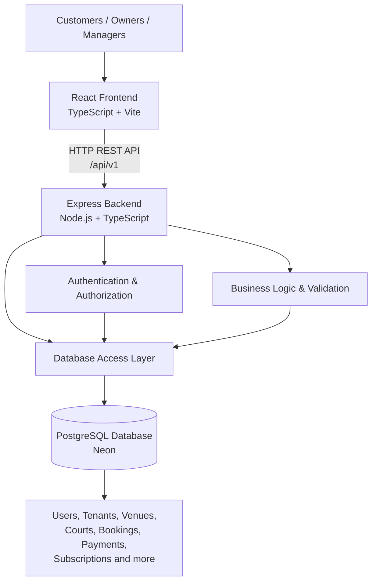

# KarurTrufs — System Architecture

## 1. Introduction

KarurTrufs is an owner-first SaaS platform designed to help turf and sports venue owners manage their businesses digitally.

The platform allows business owners to manage multiple venues, courts, operating hours, pricing, bookings, payments, and revenue.

Customers can discover venues, check court availability, and book slots online.

KarurTrufs follows a modular monolith architecture with a separate frontend, backend, and shared PostgreSQL database.

## 2. Technology Stack

| Layer | Technology | Purpose |
|---|---|---|
| Frontend | React | Build the user interface |
| Frontend language | TypeScript | Type safety and maintainability |
| Frontend tooling | Vite | Development server and build tooling |
| Backend runtime | Node.js | Execute server-side JavaScript |
| Backend framework | Express.js | Build REST APIs |
| Backend language | TypeScript | Type safety in backend code |
| Database | PostgreSQL | Store application data |
| Database hosting | Neon | Cloud-hosted PostgreSQL |
| Database driver | pg | Connect the Node.js backend to PostgreSQL |

### Why this stack?

**React + TypeScript**

React provides reusable UI components. TypeScript helps identify type-related errors during development and makes the frontend easier to maintain.

**Node.js + Express + TypeScript**

Node.js allows us to use TypeScript/JavaScript across the application. Express provides a lightweight framework for building REST APIs.

**PostgreSQL**

Our application has complex relationships between users, businesses, venues, courts, bookings, payments, and subscriptions.

PostgreSQL provides relational integrity, transactions, constraints, indexes, and advanced data types that are useful for these requirements.

**Neon**

Neon provides a managed cloud PostgreSQL database. We selected it after encountering local PostgreSQL authentication issues during initial setup.

## 3. High-Level Architecture



### Request flow

1. A customer, owner, or manager interacts with the React frontend.
2. The frontend sends an HTTP request to the backend.
3. The Express backend receives the request through a REST API endpoint.
4. Authentication identifies the user.
5. Authorization checks what the user is allowed to access.
6. Business logic validates the requested operation.
7. The backend communicates with PostgreSQL.
8. The backend returns a response to the frontend.
9. The frontend displays the result.

The frontend must never directly access the Neon database.

## 4. Application Structure

The frontend and backend are maintained as separate applications.

```text
KarurTrufs/
│
├── frontend/
│   └── React + TypeScript + Vite application
│
├── backend/
│   └── Node.js + Express + TypeScript application
│
├── database/
│   ├── migrations/
│   ├── seeds/
│   └── exports/
│
├── docs/
│   ├── architecture.md
│   ├── database-design.md
│   ├── database-relationships.md
│   └── development-roadmap.md
│
└── README.md
```

### Why separate frontend and backend?

- Frontend and backend can be developed independently.
- The backend can serve multiple clients in the future.
- A mobile application can be added later without replacing the backend.
- Each application can have its own development and deployment workflow.
- The separation makes the project easier to maintain.

## 5. Backend Architecture: Modular Monolith

We chose a modular monolith instead of microservices.

A modular monolith means the application runs as one backend system but its code is organized into separate business modules.

Expected modules include:

| Module | Responsibility |
|---|---|
| Authentication | Login, registration, OTP, Google authentication and sessions |
| Users | User profile management |
| Tenants | Business registration and ownership |
| Venues | Venue creation and management |
| Courts | Court management |
| Operating Hours | Court schedules |
| Pricing | Weekly pricing and date-specific overrides |
| Availability | Find available booking slots |
| Bookings | Create, confirm, cancel and expire bookings |
| Payments | Customer booking payments and refunds |
| Subscriptions | Venue subscription billing |
| Managers | Venue-level manager assignments and permissions |
| Notifications | In-app and future external notifications |
| Reports | Revenue and booking reports |
| Audit Logs | Record important application actions |

### Why not microservices?

At the current stage:

- The product is still being developed.
- We do not need independent deployment of dozens of services.
- A modular monolith is easier to debug and test.
- It avoids unnecessary infrastructure complexity.
- The modules can be separated into services later if actual scaling requirements justify it.

## 6. Multi-Tenant Architecture

KarurTrufs uses a shared PostgreSQL database with tenant-based data isolation.

A tenant represents a business.

A tenant can own multiple venues, and each venue can contain multiple courts.

Example:

```text
KarurTrufs
│
├── Business A
│   ├── Venue 1
│   │   ├── Court 1
│   │   └── Court 2
│   │
│   └── Venue 2
│       └── Court 1
│
└── Business B
    └── Venue 1
        ├── Court 1
        └── Court 2
```

### Why one shared database?

- Easier database maintenance.
- Centralized schema migrations.
- Simpler backups.
- Easier SaaS-wide reporting.
- Less infrastructure complexity for an early-stage product.

### Tenant isolation

The backend is responsible for enforcing tenant isolation.

A user must only access data belonging to businesses and venues they are authorized to access.

The backend must not trust a `tenant_id` received from the frontend as proof of permission.

Instead, it must derive the user's authorized tenant and venue scope from authenticated identity and database relationships.

PostgreSQL Row-Level Security (RLS) is not currently implemented. It may be considered as an additional security layer later.

## 7. User Roles

KarurTrufs initially supports three user types.

### Owner

The owner manages the business and all its venues.

Responsibilities include:

- Business management.
- Venue management.
- Court management.
- Operating hours.
- Pricing.
- Bookings.
- Revenue reports.
- Subscriptions.
- Manager assignments.

### Manager

Managers receive access only to specifically assigned venues.

They can:

- View bookings.
- View customer details.
- View revenue reports.

They cannot modify courts, pricing, operating hours, subscriptions, or other owner-controlled settings.

### Customer

Customers can:

- Browse venues.
- Check availability.
- Book slots.
- Make payments.
- View their bookings.

## 8. Database Architecture

The application uses one shared PostgreSQL database hosted on Neon.

The database contains related entities such as:

- Users.
- Tenants.
- Tenant memberships.
- Venues.
- Courts.
- Operating hours.
- Pricing rules.
- Bookings.
- Booking items.
- Payments.
- Refunds.
- Subscriptions.
- Notifications.
- Audit logs.
- Authentication identities.
- Sessions.
- Manager assignments.

Database migrations are stored in:

`database/migrations/`

The database schema is versioned through the `schema_migrations` table.

Forty numbered migrations have been executed and recorded so far.

A proper automated migration runner has not yet been implemented.

## 9. API Architecture

The backend exposes REST APIs.

All API endpoints use the version prefix:

`/api/v1`

Example endpoint structure:

```text
/api/v1/auth
/api/v1/users
/api/v1/tenants
/api/v1/venues
/api/v1/courts
/api/v1/operating-hours
/api/v1/pricing
/api/v1/availability
/api/v1/bookings
/api/v1/payments
/api/v1/subscriptions
/api/v1/reports
```

These are planned API route groups, not a claim that all endpoints already exist.

The frontend communicates with the backend through HTTP requests.

The backend validates requests, checks permissions, executes business logic, and interacts with PostgreSQL.

## 10. Important Business Logic Boundaries

Some operations require special care.

### Booking concurrency

Two customers must not successfully book the same court and time period.

PostgreSQL exclusion constraints help prevent overlapping active bookings.

The backend must also use transactions and handle database conflicts correctly.

### Temporary booking holds

A selected slot is held for three minutes while payment is completed.

A background expiry service must update expired HOLD bookings to EXPIRED so the slot can become available again.

### Pricing

The system supports recurring weekly pricing and date-specific overrides.

Date-specific pricing takes priority over recurring pricing.

Existing bookings preserve their original price snapshots.

### Payments

Payment webhook processing must be idempotent.

Repeated provider notifications must not produce duplicate payment effects.

### Authorization

The backend must enforce owner, manager, and customer permissions on every protected operation.

## 11. External Integrations Planned

These integrations are planned but have not all been implemented:

| Integration | Purpose |
|---|---|
| Google OAuth | User authentication |
| OTP provider | Phone verification and login |
| Razorpay/UPI | Customer booking payments |
| Google Maps | Venue location and maps |
| Email/SMS/WhatsApp providers | External notifications |

## 12. Current Implementation Status

### Completed

- React + TypeScript + Vite frontend setup.
- Node.js + Express + TypeScript backend setup.
- Neon PostgreSQL project setup.
- Database connectivity.
- Initial database schema.
- 40 numbered SQL migrations executed and recorded.
- Database constraints and indexes reviewed.
- Schema migration tracking table created.
- PostgreSQL schema exported.
- ER diagram generated using dbdiagram.io.
- Documentation files created.

### Not yet completed

- Automated migration runner.
- Complete database documentation.
- Backend module implementation.
- Authentication and authorization.
- Booking and payment business logic.
- Booking expiry worker.
- Frontend product features.
- Automated tests.
- Deployment and monitoring.

## 13. Future Scalability

The initial architecture is intentionally simple.

Future improvements may include:

- Mobile application using the same backend APIs.
- Background job processing.
- Caching for availability queries.
- Advanced reporting.
- Rules-based dynamic pricing followed by ML-based pricing.
- Additional notification providers.
- Database Row-Level Security.
- Service separation if justified by future scaling requirements.

These improvements should be introduced only when there is a real need.

## 14. Architecture Summary

KarurTrufs uses:

- React + TypeScript for the frontend.
- Node.js + Express + TypeScript for the backend.
- PostgreSQL hosted on Neon for persistent data.
- REST APIs for frontend/backend communication.
- A modular monolith backend.
- A shared multi-tenant database.
- Backend-enforced authorization and tenant isolation.

The goal is to build a maintainable, secure, and scalable SaaS product without introducing unnecessary architectural complexity during the initial development stage.